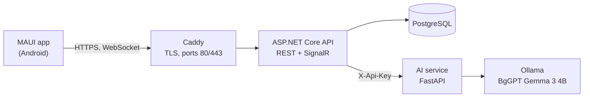

# WardlineAI

An anonymous, free, 24/7 support app for people at risk of addiction and for their parents. Android client (.NET MAUI), ASP.NET Core API, a Python AI service and a locally hosted Bulgarian language model.

> **Not a medical device and not a substitute for professional help.** It is a portfolio project. If you or someone else is in danger, call 112 or a local crisis line.

## What it does

- **Anonymous by design.** No name, phone number or email is asked for. The app starts an anonymous session; there is deliberately no password reset because there is no contact detail that could prove ownership of an account.
- **Two modes**, chosen at onboarding: "Имам проблем" (a person at risk) and "Аз съм родител" (a parent).
- **AI companion chat** with streaming replies, running on a local model (no third-party LLM API, so conversations do not leave the server).
- **Recovery diary** with mood, craving, triggers and what helped; encrypted notes and a pattern summary once there is enough data.
- **Risk prediction and a personal action plan** ("Първата крачка") with small daily tasks, plus progress tracking.
- **SOS**: crisis resources and trusted contacts.
- **Gamification**: points, levels, badges and daily challenges.
- **Education content** managed from a small web admin page (`/admin`) without a redeploy.
- **Optional parents' peer chat** (parent mode only, switchable off with one setting; off in the demo deployment).

## Architecture



Only Caddy publishes ports. The database, the AI service and the model server are reachable only inside the Docker network.

| Part | Technology |
| --- | --- |
| Client | .NET MAUI (Android, iOS target) |
| API | ASP.NET Core (net10.0), EF Core, Npgsql, SignalR, JWT |
| Database | PostgreSQL 16, migrations applied at startup |
| AI service | Python 3.12, FastAPI, scikit-learn, httpx |
| Model | `INSAIT-Institute/BgGPT-Gemma-3-4B-IT-GGUF` (Q4_K_M) served by Ollama |
| Deployment | Docker Compose, Caddy with Let's Encrypt, CI workflows in `.github/workflows` |

## Design decisions worth knowing

- **Crisis and harm-related messages never reach the model.** They are answered from reviewed fixed text.
- **A reply bank is the safety net.** If the model does not produce a first token within a deadline, the user gets a fixed, safe answer instead of a hanging chat.
- **The AI service is an internal service.** The API owns authentication and rate limits; the AI service only accepts requests carrying a shared secret.
- **Sensitive content is encrypted in the application layer** (AES-GCM): chat messages, conversation summaries, diary notes and trusted contacts. The encryption key lives only in the server's environment and is never rotated, so a database dump without it is unreadable.
- **Admin tokens are short-lived** (60 minutes) and there is no sign-up or "promote" endpoint: the admin account is created by a one-off command on the server.
- **Secrets are generated on the server.** Nothing real is committed; `.env` is git-ignored and `.env.production.example` documents every value.

## Measured performance

The model runs on CPU only. On a 6 vCPU / 12 GB VPS, a 10-turn Bulgarian conversation through the public HTTPS and WebSocket path gave (`scripts/bench-chat.py`, 6 threads):

| | |
| --- | --- |
| First token, median | 9.4 s |
| First token, slowest | 52.5 s |
| Whole reply, median | 30.5 s |
| Answered by the model | 10 of 10 |

The slow turns are those where the prompt cache is lost. This is a single-user benchmark; several simultaneous conversations would queue behind one model.

## Limitations

- A screening and support aid, not a clinical instrument; it does not diagnose.
- Parent mode is self-declared and not verified.
- CPU inference is slow; there is one model and it handles one request at a time.
- Some diary fields (for example mood and craving values) are stored as plain columns; the free-text content is encrypted.
- No password reset, by design.

## Repository layout

```
backend/WardlineAI.Api/   ASP.NET Core API, migrations, /admin static page
ai-service/               FastAPI service, risk prediction, calls Ollama
client/WardlineAI.Maui/   Android / iOS app
deploy/                   production guide and server runbook
scripts/                  chat benchmark and demo scripts
docker-compose*.yml       development and production stacks
```

## Running it

Docker Compose is the supported way. `docker compose up -d` starts PostgreSQL, the AI service, Ollama and the API. For a production-style server with TLS, see `deploy/DEPLOY.md`.

## Releases

A signed demo APK is published in the public [WardlineAI-releases](https://github.com/Ra4i/WardlineAI-releases) repository.
